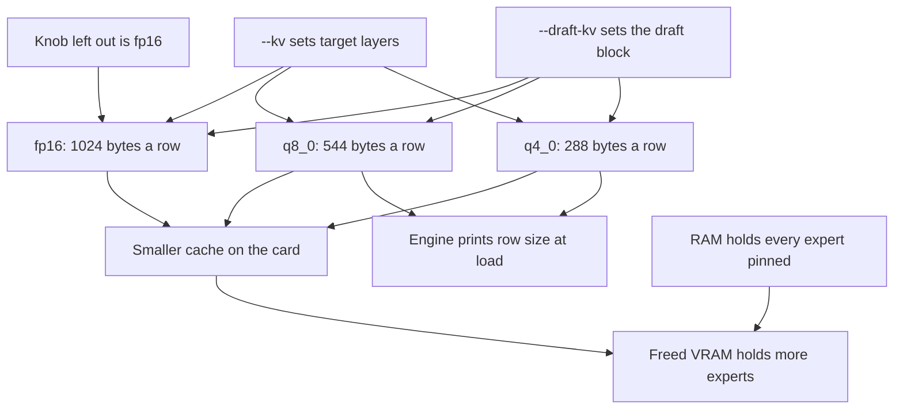

← [Prev](MODELS.md) · [Index](INDEX.md) · [Next](BACKENDS.md) →

# The KV cache formats (`hyper --kv`, `--draft-kv`)

*Needs: coverage scope known, defaults running · Gives: KV format knobs, VRAM savings, status · Next: BACKENDS.md*
*Run 2/13*

q4_0 KV cache cuts Qwen3.6-35B-A3B KV memory to 9/32 of fp16 per row (288 vs 1024 bytes) — what fits on 8 GB VRAM.

`hyper` can store its attention K and V caches in the ggml **Q8_0** or **Q4_0** formats instead of
fp16. There are two independent knobs: `--kv fmt` for the target model and `--draft-kv fmt` for the block
that guesses ahead, each `fp16 | q8_0 | q4_0`, mixable (e.g. `--kv q8_0 --draft-kv q4_0`). A knob left out
is `fp16`. The default (both knobs fp16) is byte-identical to pre-q4_0 build per 12/12 short-prompt check (poly_kv_q8_test + fp16/Q8_0 reply comparison); re-run after any engine edit.

q8_0 is measured (single-knob engine): see [q8_0](#q8_0) below. q4_0 is REPORTED once (no server log on file —
NOT measured): a live agent run under `--kv q4_0 --draft-kv q4_0` (q4-001, see [BENCHMARKS.md](BENCHMARKS.md)
for numbers — all REPORTED, unverified; thinking-cap and zero-error claims UNVERIFIED, no log), plus kernel
unit tests (`poly_kv_q4_test`: key and value readers against the ggml oracle, 112,010 values) and a
mixed-knob engine test (`poly_draft_race_test`: PASS, 5/5 pairs, rows round-trip 6/6). A frozen-fixture A/B
against fp16/q8_0 is still pending — figures that need one stay marked **PENDING**.

## The three formats

A cache row holds one token's value for each KV head and each head dimension (`n_kv * head_dim` values).
Stored as fp16 that is `2 * n_kv * head_dim` bytes a token for K and, again, for V.

- **fp16** (default, unchanged): 2 bytes a value, as above.
- **q8_0**: cut into 32-value blocks: for every block of 32 values, one fp16 **scale** (the block's
  largest magnitude over 127) and 32 **int8 codes**. Attention dequantizes a block with its scale on the
  fly while it computes the scores and the outputs. Measured: see [q8_0](#q8_0).
- **q4_0**: cut into 32-value blocks, transcribed from ggml's `quantize_row_q4_0_ref`. The
  block's **scale** is `d = max / -8`, where `max` is the value with the largest magnitude in the block,
  sign kept — so `d` may be negative, and is stored as is (fp16). Each value's **code** is
  `min(15, trunc(x / d + 8.5))`: C truncation toward zero with an upper clamp only and no lower clamp —
  an asymmetric 16-step grid anchored at the block's signed extreme. Values `j` and `j + 16` (`j` < 16)
  share byte `j` as its low and high nibbles (16 packed bytes a block). Reading back is
  `(nibble - 8) * d` with the stored scale as is, so a negative `d` reads correctly. Only this per-block
  arithmetic follows ggml: the planes are the engine's own — all quants in one plane, all fp16 scales in
  another — for the fused readers, not ggml's interleaved `{d, qs[16]}` blocks.

Block arithmetic (definitional, no run needed): a q4_0 block is 16 packed bytes plus one fp16 scale, 18
bytes per 32 values — **9/32 of the fp16 row and 9/17 of the q8_0 row**. On Qwen3.6 (`n_kv * head_dim` =
512: 2 KV heads × key length 256) that is 288 bytes a K or V row, printed by the engine at load
(`q4_0 KV cache: 288 bytes a row`, confirmed in q4-001), vs 1024 fp16 and 544 q8_0. Per layer (K+V):
2048 / 1088 / 576 bytes a token. Only 10 QSA target layers plus the draft layer hold KV (11 rows a
token, same geometry); GDN layers keep recurrent state, not KV rows. At full 131072 context that is
11 × per-layer bytes × 131072: fp16 ≈ 2.75 GiB, q8_0 ≈ 1.46 GiB, q4_0 ≈ 0.77 GiB by row
arithmetic (measured q4_0 reservation ≈ 0.91 GiB) — 71.9% saved vs
fp16, 47.1% vs q8_0. Whether freed VRAM converts to resident experts at long context is PENDING (needs
the frozen A/B).

## The two knobs

`--kv` sets the target model's layers; `--draft-kv` sets the guessing block's layer, independently. In
`strata-*.json` they ride as flat pairs, e.g. `["--kv", "q8_0", "--draft-kv", "q4_0"]` appended to `args`;
a knob omitted is `fp16`. Unknown values exit 2.

| target (`--kv`) | draft (`--draft-kv`) | answers / speed |
| --- | --- | --- |
| fp16 | fp16 | The default (both knobs fp16) is byte-identical to pre-q4_0 build per 12/12 short-prompt check (poly_kv_q8_test + fp16/Q8_0 reply comparison); re-run after any engine edit. |
| fp16 | q8_0 | mixed-knob engine test only (draft_race, acceptance +6.25pp vs control, rows exact); no live run |
| fp16 | q4_0 | unmeasured (PENDING) |
| q8_0 | fp16 | mixed-knob engine test only (acceptance +12.50pp vs control, rows exact); no live run |
| q8_0 | q8_0 | unmeasured as a combination (PENDING): the single-knob `--kv q8_0` parity in [q8_0](#q8_0) is the nearest measured result, not this combination |
| q8_0 | q4_0 | mixed-knob engine test only (acceptance +12.50pp vs control, rows exact); no live run |
| q4_0 | fp16 | unmeasured (PENDING) |
| q4_0 | q8_0 | mixed-knob engine test only (acceptance +2.08pp vs control, rows exact); no live run |
| q4_0 | q4_0 | REPORTED once live (q4-001, REPORTED not log-verified, section above) + engine test (acceptance +2.08pp, rows exact) |

## q8_0

A q8_0 row is cut into 32-value blocks; the format is defined under [The three formats](#the-three-formats).
`--kv q8_0` needs `n_kv * head_dim` to be a multiple of 32; the models here are. A shape that is not gets a
clear error rather than a wrong answer. The engine prints its row size at load:

```
hyper: q8_0 KV cache: 544 bytes a row
```

544 = 512 codes + 2 blocks × 2 scales, a head, K and V.

All three models loaded and answered with `--kv q8_0` at the full 131072-token context, and with a picture
through the vision encoder (`hyper-vision`), each replying `KV OK` to the fixed prompt.

### What it was measured on

| | |
| --- | --- |
| Graphics card | NVIDIA RTX 3070, 8192 MiB |
| CPU | 24 threads |
| Built with | CUDA (the CUDA build of `hyper`); `/opt/cuda` |
| Models | `Tiel-Coder-35B-A3B.APEX-I-MiniPlus-V2.1.gguf`, `Ornith-1.5-35B-A3B.APEX-I-MiniPlus-V2.1.gguf`, `Occamy-1.0.APEX-I-MiniPlus-V2.1.gguf`, all `qwen35moe`, Q4_K - Medium |
| Context | 131072 tokens |
| Server | `serve/server.py --engine strata --config strata-<model>.json --port 8099` |

### Parity with fp16

With greedy sampling (`temperature: 0`, which the engine reads as its own greedy), `--no-draft` so the
speculative path cannot change a token (`timings.draft_n` was 0 on every request), and `max_tokens: 64`, the
fp16 and Q8_0 arms were compared over five prompts each: the four short factual ones and one open-ended
sentence about the colour blue.

| model | exact matches | mean character agreement | longest common prefix |
| --- | ---: | ---: | --- |
| Tiel Coder 35B-A3B | 5/5 | 1.0000 | full reply (137 chars) |
| Ornith 1.5 35B-A3B | 5/5 | 1.0000 | full reply (129 chars) |
| Occamy 1.0 | 5/5 | 1.0000 | full reply (173 chars) |
| **all three** | **15/15** | **1.0000** | — |

Every Q8_0 answer equals the fp16 one character for character. The short factual prompts (`KV OK`, `42`,
`Paris`, `2, 3, 5, 7, 11`) also equal the pre-change fp16 baseline byte for byte on all three models
(12/12), which is how the default path's byte-identity was checked; the open-ended fifth prompt is not
bit-stable at greedy on Ornith and Occamy even before this change (speculative drafts on Ornith, `--tail-skip`
and the adaptive expert cache on Occamy), so it is not used for that check. The engine/API does not return
tokens, so agreement is measured on the reply text (longest common prefix and per-prompt agreement).

### What it saves

Per token, and in total at a full 131072-token context:

| model | attention layers | Q8_0 a token | fp16 a token | Q8_0 at 131072 | fp16 at 131072 | saved |
| --- | ---: | ---: | ---: | ---: | ---: | ---: |
| Tiel | 11 | 11 968 B | 22 528 B | 1.461 GiB | 2.750 GiB | 1.289 GiB |
| Ornith | 11 | 11 968 B | 22 528 B | 1.461 GiB | 2.750 GiB | 1.289 GiB |
| Occamy | 10 | 10 880 B | 20 480 B | 1.328 GiB | 2.500 GiB | 1.172 GiB |

**46.88% less KV VRAM** for all three, matching the per-token arithmetic exactly.

The engine's default KV cache grows as the conversation does, so a short prompt barely moves the load-time
expert cache — but with `--kv-whole`, which reserves the whole context's KV at load, the freed VRAM goes to
experts. At 131072 the expert cache under `--kv-whole` rose

```
Tiel   fp16: 1237 of 10496 experts (1.5 GiB)   q8_0: 2319 of 10496 (2.8 GiB)   +1082 experts
Ornith fp16: 1237 of 10496 experts (1.5 GiB)   q8_0: 2313 of 10496 (2.8 GiB)   +1076 experts
Occamy fp16: 1503 of 10240 experts (1.8 GiB)   q8_0: 2480 of 10240 (2.9 GiB)    +977 experts
```

with the same free VRAM left per model at the end.

### What it costs

At a 972-token prompt, 128-token answers, greedy, `--no-draft`, `--vram-reserve-mib 512` (see the caveat),
each arm a fresh process, median of four steps:

| model | arm | prompt tok/s | decode tok/s |
| --- | --- | ---: | ---: |
| Tiel | fp16 | 1014.6 | 105.8 |
| Tiel | q8_0 | 1008.0 | 105.2 |
| Ornith | fp16 | 1022.8 | 106.5 |
| Ornith | q8_0 | 1008.4 | 106.2 |
| Occamy | fp16 | 1031.8 | 107.1 |
| Occamy | q8_0 | 1034.1 | 106.9 |

Q8_0 against fp16: prompt **−1.4% to +0.2%**, decode **−0.6% to −0.2%** — within run-to-run scatter.

### A caveat that is not about q8_0

At 131072 with the default 256 MiB reserve, long chats intermittently fail with
a `cudaGraphInstantiate` allocation failure: the engine grows the expert cache down to 128 MiB free, then a newly
recorded CUDA graph needs more than what is left. This is **pre-existing and general**: it reproduces on the
unchanged fp16 path too, so it is not caused by `--kv q8_0`. `--vram-reserve-mib 512` removes it — all four
model/format combinations, eight requests each, with and without a picture, saw zero allocation failures. The numbers above
were taken with that 512 MiB reserve.

The three run configs (`strata-tiel.json`, `strata-ornith.json` and `strata-occamy.json`) now ship with
`--vram-reserve-mib 512`, so the failure does not occur with them. With that reserve, Tiel at the full
131072-token context loads 3481 of 10496 routed experts into VRAM (4.1 GiB), measured on the RTX 3070 below.

### Comparison with another implementation

`llama.cpp` (the in-tree build `runners/llama.cpp/build/bin/llama-cli`) reads the same `qwen35moe` files and
accepts `-ctk q8_0 -ctv q8_0`. Given a Q8_0 KV cache it answered the two short fixed prompts
(`Reply with exactly: KV OK` → `KV OK`; `What is 17 + 25? Answer with just the number.` → `42`), the same
tokens the `hyper` engine's `--kv q8_0` produced on all three models. It was run on the CPU (`-ngl 0`) because the
file is far larger than the card; only the short deterministic answers are a meaningful signal across engines.

### Builds

- **CUDA:** builds clean; the test-suite run on post-f72a15e9 CUDA build is 116/117; the one failure,
  ple_parity, is the missing 20 GB Q2_0 fixture (by design), unrelated to this change.
  `poly_kv_q8_test` passes (0.23 s).
- **HIP:** build deferred — this machine has no ROCm. The clean-rejection guard below is in place.
- **SYCL:** not applicable; that is a separate engine.

## q4_0

No frozen-prompt q4_0 arm has been compared against fp16. What exists: the kernel unit tests (key and
value readers vs the ggml oracle, 112,010 values, PASS), the mixed-knob engine test (acceptance within
+2.08…+12.50pp of the fp16 control on all five pairs, never a drop; save/load rows bit-exact 6/6), and
one full live agent run with zero errors. A failed exact prefix/tool match on a draft-only pair during
testing was investigated and found legitimate: a speculative walk diverges under any draft quantization
by construction (different guesses accept different runs), so those gates report but do not fail.

### What q4_0 saves

Per row, by block arithmetic: 9/32 of fp16, 9/17 of q8_0 — on Qwen3.6, 288 / 1024 / 544 bytes a K or V
row. At-context totals from the layer count (11 KV-holding layers: 10 QSA + draft; GDN keeps
recurrent state, not KV rows): fp16 ≈ 2.75 GiB, q8_0 ≈ 1.46 GiB, q4_0 ≈ 0.77 GiB by row arithmetic
(measured ≈ 0.91 GiB) at full 131072 context. At-run-context GiB figures WITHDRAWN 2026-10-18 — PENDING:
no log on file, run context unverified, and the stated ≈1.8 / 0.9 / 0.5 GiB at ~78K conflicts with
11-layer arithmetic (≈1.6 / 0.9 / 0.5). Recompute only from the log once it lands. With `--kv-whole`, which reserves the whole context's KV at load, freed VRAM goes to experts as
with q8_0; measured conversion under q4_0 at long context: PENDING (needs the frozen A/B).



### What q4_0 costs

One REPORTED data point (no log on file — UNVERIFIED), no controlled comparison: q4-001 numbers live in
[BENCHMARKS.md](BENCHMARKS.md) (not retyped here) — no speed claim either way; "in line with fp16/q8_0 scatter" is
UNVERIFIED without the log, not a finding. Per-pair ms/round from the engine test: 54–89 ms/round across knobs (mildly
slower on quantized drafts, slowness alone is not gated). Frozen-fixture decode numbers: PENDING.

## Gates, and what was left alone

- qwen35moe-only, per knob: `--kv <val> is only supported for qwen35moe models in v1; this is a '<arch>'
  model` (the same with `--draft-kv`), not run.
- CUDA-only, per knob: `--kv <val> is not supported on this backend (CUDA only)` (the same with
  `--draft-kv`), and the engine exits, rather than doing something different. The HIP build itself was not
  run here (no ROCm on this machine).
- Like q8_0, q4_0 works in 32-value blocks: a shape whose `n_kv * head_dim` or `head_dim` is not a
  multiple of 32 gets a clear error naming the offending knob(s) rather than a wrong answer.
- The `strata` engine, and its own `--kv int8`. Nothing in it changed.
- `glm5next` / GLM 5.3 Flash (`dsa_attend`): its attention is not the one these caches quantize, so
  neither knob is offered for it.
- **Gemma 4 is out of v1**, per knob as with q8_0.
- The default (both knobs fp16) is byte-identical to pre-q4_0 build per 12/12 short-prompt check (poly_kv_q8_test + fp16/Q8_0 reply comparison); re-run after any engine edit.

## Where it lives

- `src/poly/` — the q8_0 and q4_0 cache pointers, allocation, save/load, the row-size print, and the
  attention path that reads codes/scales+quants (`qwen35.*`, `kernels.cu`, `kernels.hpp`), the `KvFmt` and
  `Options::kv_format` definition (`engine.hpp`), the `--kv` / `--draft-kv` parsing and gates (`main.cpp`,
  `engine.cpp`), the kernel unit tests (`kv_q8_test.cpp`, `kv_q4_test.cpp`), and the mixed-knob engine test
  (`draft_race_test.cpp`).
- `setup.py` — the `--kv` / `--draft-kv` writer, reader, and keep-paths.
- `CMakeLists.txt` — the `poly_kv_q8_test` and `poly_kv_q4_test` targets and their `add_test`.
- `strata-tiel.json`, `strata-ornith.json`, `strata-occamy.json` — the run configs carry `--kv q8_0` and
  `--vram-reserve-mib 512`.
- Docs — this file for both formats and knobs.

← [Prev](MODELS.md) · [Index](INDEX.md) · [Next](BACKENDS.md) →
